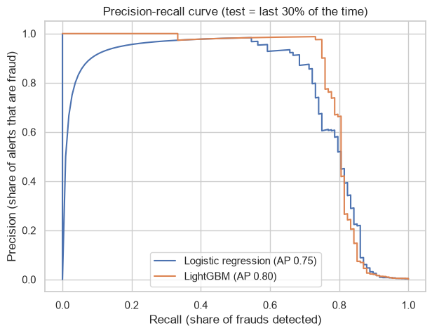
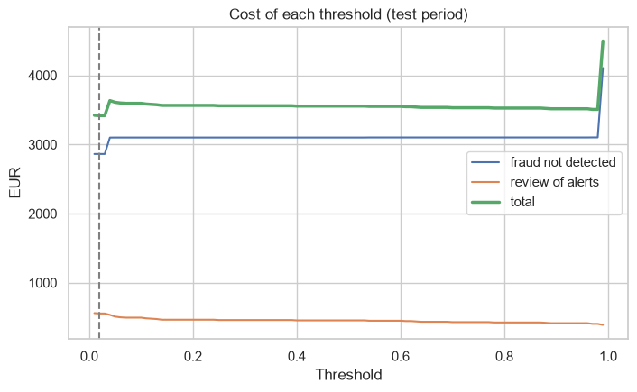

# Credit card fraud detection: imbalanced data, a threshold chosen by cost, and SHAP

A fraud model built the way a payments or bank risk team would do it:
- the split is by **time**: we train with the past and test with the future;
- the metrics are for very imbalanced data (precision-recall);
- the alert threshold comes from the **cost** of each error;
- the alerts are explained with SHAP;
- a stability check of the score (PSI) closes the project.

**Data:** "Credit Card Fraud Detection" (ULB Machine Learning Group and Worldline), OpenML dataset 1597. It has 284.807 card transactions of two days of September 2013, 492 of them frauds (0.17%). Variables V1 to V28 are anonymised PCA components.

## Results
| Model | ROC-AUC | Average precision |
|---|---|---|
| Logistic regression | 0.979 | 0.749 |
| LightGBM | 0.980 | 0.799 |

- The ROC-AUC looks excellent for both models. With 0.17% of frauds, though, the average precision is the metric that shows the difference (a random model gets 0.0013).
- **Cost:** a missed fraud costs its amount, and every alert costs 5 EUR of manual review.
  - In the test period the frauds add up to 14.567 EUR.
  - With LightGBM and a threshold of 0.02, the total cost falls to 3.418 EUR (77% less), with 111 alerts and 84 of 108 frauds caught.
- **SHAP:** the variables that move the score the most are V4, V14, V12, V1 and V8.
- **Stability:** the PSI of the score between the two halves of the test period is 0.007.




## How to run
```
pip install -r requirements.txt
jupyter notebook fraud_detection.ipynb      # the data is downloaded from OpenML the first time
```

---
Alejandro Lezcano Osorio | Rennes School of Business (MSc in Financial Data Intelligence) and Universidad EIA
